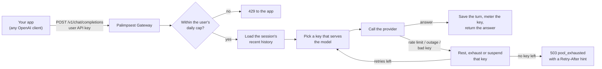

<div align="center">

<picture>
  <source media="(prefers-color-scheme: dark)" srcset="logos/logo-full-light-800.png">
  
</picture>

### One OpenAI-compatible endpoint in front of all your LLM keys.
Pool OpenAI, Anthropic, Gemini and OpenRouter keys. Fail over automatically. Keep every conversation going.

[](https://github.com/hammrouni/palimpsest-gateway/actions/workflows/ci.yml)
[](LICENSE)
[](pyproject.toml)
[](https://fastapi.tiangolo.com)
[](https://redis.io)
[](docker-compose.yml)
[](#api-reference)
[](#quick-start)

[Quick start](#quick-start) ·
[How it works](#how-a-request-flows) ·
[Features](#features) ·
[Dashboard](#operator-dashboard) ·
[User Guide](docs/USER_GUIDE.md) ·
[API reference](#api-reference)

</div>

---

**A self-hosted, OpenAI-compatible endpoint in front of the LLM provider keys you own.** Your apps talk to Palimpsest Gateway exactly as they would talk to OpenAI. Behind it, the gateway spreads requests over a pool of keys (OpenAI, Anthropic, Google Gemini, OpenRouter), moves on to another key when one hits its limit or fails, and keeps each user's conversation going across the switch.

It works the same whether your keys are paid, free-tier, or a mix. See [Using paid and free keys](#using-paid-and-free-keys).

## What problem it solves

Provider keys run out: a per-minute rate limit, a daily or monthly quota, a spending cap, an outage. Without a gateway, every app has to handle that itself: catch the `429`, pick another key, re-send the conversation. And every app needs the raw provider keys.

Palimpsest Gateway does that once, centrally:

- **Your apps get one URL and their own gateway API keys.** Provider keys stay inside the gateway, encrypted at rest, and are never shown again after they are added.
- **When a key fails, the request moves on.** A rate-limited key rests briefly, a key that reached its cap waits for its reset, a key the provider refuses is suspended, and the request is retried on the next suitable key within the same API call.
- **The conversation survives the switch.** The gateway stores each user's recent turns, so the replacement provider receives the context.
- **You can see and control everything.** The dashboard shows key health, usage, failovers, users, latency, cost against prices you enter, alerts, and an audit trail.

## How a request flows



1. **Authenticate.** The app sends its own gateway API key (`pgw_live_...`), never a provider key.
2. **Admit.** The user's daily request cap and the pool's remaining capacity are checked.
3. **Load context.** With an `X-Session-ID`, the gateway adds the session's stored history, so the app only needs to send the new message.
4. **Choose a key.** Among the keys that serve the requested model and are not resting, suspended or out of quota, see [How keys are chosen](#how-keys-are-chosen).
5. **Fail over if needed.** A failed attempt changes that key's state and the request is retried on the next key, up to a fixed retry budget. The next provider gets the system prompt, the last few turns and the current message.
6. **Answer and record.** The reply goes back in the OpenAI format (streaming or not), the turn is saved, and the key's usage is counted once.

## Key terms

| Term | Meaning |
| :--- | :--- |
| **Pool key** | A provider API key added by the operator, with the model names it serves and optional request cap, token budget and reset schedule. |
| **User account** | A consumer of the gateway (an app, a team, a person) with its own `pgw_live_...` API keys and an optional daily request cap. |
| **Session** | One conversation. History is stored per account, so no account can read another's. |
| **Operator** | You, the administrator. An operator key (`pgw_opk_...`) opens the dashboard and the operator API. |
| **Failover** | Retrying a request on another pool key after a failure, with the conversation context carried over. |

## What it is not

- **Not a model host.** It runs no models; it forwards requests to providers.
- **Not a way around provider rules.** It does not create accounts, hide who you are from a provider, or lift any provider limit. It only uses the keys you give it, within the limits those keys have. See [Using it responsibly](#using-it-responsibly).
- **Not a guarantee of capacity.** If every key is out of quota the client gets a `503`. Free tiers can be small, and a provider can change or withdraw them at any time.
- **Not internet-ready on its own.** It has no TLS and no IP rate limiting. Put a reverse proxy in front before exposing it.

## Features

- **Drop-in OpenAI API**: `/v1/chat/completions` (streaming and non-streaming, tool calls), `/v1/models`.
- **Multi-provider key pool**: OpenAI, Anthropic, Google Gemini and OpenRouter keys, each with optional request cap, token budget, reset schedule and a label.
- **Automatic failover**: rate limits, outages, exhausted quotas and rejected keys are retried on the next key within a fixed retry budget. When nothing is left, the client gets a `503` with a retry hint.
- **Conversation memory**: per-user session history, so clients send only the new message, and failover keeps the context.
- **Fairness**: per-user daily request caps and a pool low-water mark that throttles before the pool runs dry.
- **Provider detail stays internal**: responses to users carry generic messages and stable error codes. Provider key material is never returned after creation.
- **Operator dashboard**: Overview, Pool Keys, Utilization & Failover, Users, Usage, Sessions, Requests, Performance, Costs, Alerts, Audit & Export, System and Configuration.
- **Cost view from your own prices**: you enter per-model prices and an optional monthly budget; the gateway derives spend. Nothing is bundled, so prices never go stale silently.
- **Alerts**: low pool capacity, key problems, high error rate, users near their cap, with an optional webhook.
- **Audit trail and exports**: operator actions are recorded without key material; usage, requests and audit export as CSV.
- **Observability**: one structured JSON log line per request, and a Prometheus `/operator/v1/metrics` endpoint.

## Two ways in

| If you want to… | Start here |
| :--- | :--- |
| **Run it.** Point an app at it, or explore the dashboard. No code. | [Quick start](#quick-start) below. |
| **Change it.** Add an endpoint, debug a failure, send a PR. | [docs/DEVELOPMENT.md](docs/DEVELOPMENT.md). |
| **Configure or operate it.** Every setting, every error code, backup and scaling. | [docs/USER_GUIDE.md](docs/USER_GUIDE.md). |

## Quick start

### Prerequisites

- Docker, with Compose v2 (`docker compose version` should work)

That is genuinely all — the image carries Python and every dependency, and Compose starts the one backing service it needs. Nothing to compile, no virtualenv, no manual key generation.

If you do not want to use Docker, [the User Guide](docs/USER_GUIDE.md#without-compose) covers running it against your own Redis and Python.

### 1. Clone

```bash
git clone https://github.com/hammrouni/palimpsest-gateway.git
cd palimpsest-gateway
```

### 2. Run

```bash
docker compose up -d --wait
```

That is the whole setup. `--wait` blocks until the stack reports healthy.

On first boot the container generates its own **master key** (which encrypts every stored credential) and a local **operator key**, and persists both in a Docker volume so they survive restarts. Nothing to paste, no `.env` required, no manual key generation.

```
  API          http://localhost:8000
  Dashboard    http://localhost:8000/dashboard/
  API docs     http://localhost:8000/docs
```

The startup log prints the dashboard URL and your operator key (`docker compose logs app`). You can also read the key any time with:

```bash
docker compose exec app cat /app/.secrets/operator_key
```

Set `PALIMPSEST_LOG_OPERATOR_KEY=false` on any deployment whose logs are collected or shared: the key grants the whole operator realm.

> [!SECURITY]
> **Before you open this in a browser, notice where it's listening.** By default the gateway binds `127.0.0.1:8000` — loopback only — and it has no TLS and no rate limiting. If you run this on a shared machine, in a container exposed to a network, or on a VPS and open `http://localhost:8000`, you get an unauthenticated, un-TLS endpoint with **account signup on by default** (`PALIMPSEST_ALLOW_SIGNUP=true`): anyone can create an account and spend your provider keys.
>
> To keep it on loopback, do not publish port 8000 (no `ports:` entry for the host, or keep it bound to `127.0.0.1`). To expose it at all, do it deliberately: set `PALIMPSEST_BIND=0.0.0.0` and `PALIMPSEST_PORT` in `.env`, put a reverse proxy in front with TLS, and set `PALIMPSEST_ALLOW_SIGNUP=false` with a `PALIMPSEST_USER_DAILY_CAP`.

### 3. Add a provider key

The gateway starts and serves its API without one. To serve `/v1/chat/completions`, give it a key:

```bash
echo 'PALIMPSEST_PROVIDER_API_KEY=sk-your-key' >> .env
docker compose up -d
```

On startup the gateway adds that key to the pool for provider `PALIMPSEST_PROVIDER_NAME` (default `openai`), serving model `PALIMPSEST_PROVIDER_MODEL` (default `gpt-4o-mini`). Clients request that exact model string. Restarting never adds it twice.

Better still, add pool keys through the dashboard or the Operator API — they are encrypted at rest and never returned after creation. `PALIMPSEST_PROVIDER_API_KEY` is the single-key shortcut.

### 4. Create a user and call it

In the dashboard, open **Users → + New user** and copy the API key it shows (it is shown once). Then use it from any OpenAI client by changing the base URL:

```python
from openai import OpenAI

client = OpenAI(base_url="http://localhost:8000/v1", api_key="pgw_live_...")
reply = client.chat.completions.create(
    model="gpt-4o-mini",  # a model one of your pool keys serves
    messages=[{"role": "user", "content": "Hello"}],
)
print(reply.choices[0].message.content)
```

To keep a conversation going server-side, send the same `X-Session-ID` header on each request (`extra_headers={"X-Session-ID": "my-chat"}`); the first reply returns one if you send none.

### 5. Verify

```bash
curl http://localhost:8000/healthz
```

It should return `{"status":"ok"}`. Then open the dashboard and sign in with the operator key.

### Handy commands

`make help` lists them all. Every target is a thin wrapper over plain `docker compose`.

| Command | Equivalent |
| :--- | :--- |
| `make up` | `docker compose up -d --wait --build` |
| `make dev` | Hot reload against your working tree |
| `make test` / `make lint` | Tests and ruff inside the dev container |
| `make logs` | Tail application logs |
| `make shell` | Shell inside the app container |
| `make ps` | Show container status |
| `make restart` | Restart the app container |
| `make redis-cli` | Open redis-cli against the running Redis |
| `make down` | Stop containers, keep data |
| `make clean` | **Destructive** — also deletes the data volumes and the master key |
| `make rotate-secrets` | **Destructive** — generate a fresh master key and operator key |
| `make help` | List every target with its description |

### Development with hot reload

```bash
make dev
```

Your working tree is mounted into the container and uvicorn reloads on save. Run tests and lint in the same environment with `make test` and `make lint`.

To work without containers instead, see [docs/USER_GUIDE.md](docs/USER_GUIDE.md).

### Port and secret notes

- The gateway binds `127.0.0.1:8000` by default. It has no TLS and no rate limiting, so keep it on loopback. Set `PALIMPSEST_BIND=0.0.0.0` in `.env` to expose it deliberately, behind a proxy.
- `PALIMPSEST_PORT` changes the host port if 8000 is taken.
- Redis is not published to the host at all — the app reaches it over the compose network. That avoids colliding with a locally installed Redis and keeps an unauthenticated store off the network.
- **The generated master key is the root of trust for every stored credential.** It lives in the `gateway_secrets` volume. `make clean` and `docker compose down -v` destroy it, making every stored pool key permanently undecryptable. Back up that volume, or set your own `PALIMPSEST_GATE_MASTER_KEY` in `.env` so you control it.

### If something goes wrong on first run

| Symptom | Cause and fix |
| :--- | :--- |
| `Bind for 127.0.0.1:8000 failed: port is already allocated` | Something else uses 8000. Use `PALIMPSEST_PORT=8010 docker compose up -d`. |
| `failed to resolve reference "redis:..."` | Your Docker cannot pull images — often a proxy or an offline machine. Check `docker pull redis:8.2-alpine`. |
| Containers start but never become healthy | Run `docker compose logs app`. Most often the image is still building, or a stale container is holding the port: `docker compose down`. |
| `401` on every request | Send a user API key (`pgw_live_…`) for `/v1/*` and the operator key for `/dashboard/`. See steps 3 and 4 above. |
| Chat returns `503` | No pool key can serve that model: check the model name, and the key's state in **Pool Keys** (a key the provider refused is suspended automatically). |
| Chat requests fail but the dashboard works | No provider key in the pool. Set `PALIMPSEST_PROVIDER_API_KEY` in `.env`, or add a pool key through the Operator API. Everything else works without one. |
| Dashboard loads but sign-in fails | You need the operator key, not a user key: `docker compose exec app cat /app/.secrets/operator_key`. |

## Using paid and free keys

The gateway does not care how a key was obtained. It sees a provider, a model list and, optionally, a request cap. How you set those decides how the pool behaves.

### How keys are chosen

For each request, the gateway takes the keys that are `active`, serve the exact model string the client asked for, and are not resting for that model. It then orders them:

1. **Keys with a request cap and requests left**, the key with the most left first. Keys whose cap is used up are skipped until their window resets.
2. **Keys with no cap**, last.

Within each group, a key from the provider that served the earlier turns of the session is tried first.

The consequence is useful: **give limited keys a cap and leave unlimited keys uncapped, and the limited keys are used first**. The uncapped key is the fallback.

### Setups

| Your situation | How to set it up |
| :--- | :--- |
| **You pay for the keys.** You want reliability and a spending view, not rationing. | Add the keys without a request cap, or with a cap you choose as a safety limit. Enter model prices and a monthly budget under **Costs**, and turn on **Alerts**. Failover retries a key that is rate-limited or briefly down. |
| **You use free-tier keys.** You want to get the most from the allowance you have. | Add each free key with a `daily_cap` at or below that key's published allowance and the matching `reset_period_hours` / `reset_at`. The gateway spreads requests over keys with the most room left and stops sending to a key whose cap is spent until it resets. |
| **Mixed.** Free keys first, paid keys as a backstop. | Cap the free keys as above, leave the paid keys uncapped, and list the **same model string** on both. Free capacity is used first; paid capacity takes over when it runs out. |

### Things to know before you rely on it

- **The model string must match.** Failover only moves to a key that lists the same model string the client sent. A free key and a paid key that should back each other up must both list that string. Models with different names are different models to the gateway.
- **Caps are yours to set.** The gateway does not know a provider's allowance, so a cap is only as right as the number you enter. Allowances change; check the provider's current limits. For OpenRouter keys the dashboard can show the provider's own view of the key's remaining free requests.
- **The request cap is enforced; the token budget is not.** `daily_cap` stops a key from being picked. `token_cap` is an indicator on the dashboard and never blocks a key.
- **Usage outside the gateway is invisible to the gateway.** If a key is also used elsewhere, the gateway's count is a floor. The provider's own refusal (rate limit, quota) still triggers failover.
- **Free tiers are small and can change.** Expect `503 pool_exhausted` when every free key is spent and no backstop exists. The response carries `Retry-After` and `X-Palimpsest-Next-Reset` where a reset time is known.
- **Per-user limits are account-wide.** Every account shares the same daily request cap, which you can override for one account until the next UTC midnight. There is no per-user model or key restriction; an account can use any model the pool serves. If different groups need different keys, run separate gateways.
- **Free tiers may handle prompts differently.** Some providers use free-tier traffic to improve their products, or log it. Read each provider's terms before sending anything private through a free key.

## Using it responsibly

- **Use keys you are entitled to use.** Add keys that belong to you or your organization, for the purpose their terms allow.
- **Do not multiply free allowances.** Do not create extra accounts or projects only to collect more free keys. Providers generally prohibit this, and an account can be closed for it. The gateway makes spreading load easy; it does not make that permitted.
- **Check sharing rules before you give others access.** Many providers restrict sharing or reselling API access. If other people use your gateway, confirm what each provider's terms allow for your case. Gateway accounts are meant for your own apps and people you are responsible for.
- **Keep signup closed on anything reachable.** With `PALIMPSEST_ALLOW_SIGNUP=true` (the default), anyone who can reach the gateway can create an account and spend your keys. Set it to `false`, and set a `PALIMPSEST_USER_DAILY_CAP`.
- **You are responsible for what your users send.** Provider rules apply to the content passing through your keys, not to the gateway.

## Configuration

Everything is configured through `PALIMPSEST_*` environment variables. The full reference — every knob, its default and its bounds — is in [docs/USER_GUIDE.md](docs/USER_GUIDE.md).

| Variable | Default | Description |
| :--- | :--- | :--- |
| `PALIMPSEST_GATE_MASTER_KEY` | generated | Fernet key encrypting credentials at rest. Not recoverable. |
| `PALIMPSEST_GATE_OPERATOR_KEY` | generated | Bootstrap operator key, seeded idempotently on startup. |
| `PALIMPSEST_LOG_OPERATOR_KEY` | `true` | Print the operator key and dashboard URL in the startup log. |
| `PALIMPSEST_PROVIDER_API_KEY` | — | Single-key shortcut: added to the pool on startup. |
| `PALIMPSEST_PROVIDER_NAME` | `openai` | Provider of that key: `openai`, `anthropic`, `google` or `openrouter`. |
| `PALIMPSEST_PROVIDER_MODEL` | `gpt-4o-mini` | Model that key serves; clients request this string. |
| `PALIMPSEST_PROVIDER_TIMEOUT` | `60` | Seconds per provider attempt. |
| `PALIMPSEST_ALLOW_SIGNUP` | `true` | Self-service `POST /v1/accounts`. Set `false` on any reachable gateway: then only an operator key can create accounts. |
| `PALIMPSEST_REDIS_URL` | `redis://redis:6379/0` | Store location (Compose default). |
| `PALIMPSEST_RETRY_BUDGET` | `3` | Retries after the first attempt (so at most 4 provider calls). Spending it returns `budget_exhausted`. |
| `PALIMPSEST_COOLDOWN_SECONDS` | `60` | How long a key rests after a transient failure. |
| `PALIMPSEST_VERBATIM_TURNS_N` | `4` | Recent turns re-sent verbatim when a provider fails over. |
| `PALIMPSEST_USER_DAILY_CAP` | — | Per-user daily request cap. Unset = no per-user cap. |

*13 of ~40 settings; full reference with defaults and bounds → [docs/USER_GUIDE.md](docs/USER_GUIDE.md)*

Most of these are also tunable at runtime through the Operator API, without a restart.

## API reference

Errors always use the OpenAI envelope: `{"error": {"type", "message", "param", "code"}}`.

### User realm — authenticate with a user API key

| Endpoint | Method | Description |
| :--- | :--- | :--- |
| `/v1/accounts` | `POST` | Create an account; the API key is returned once and never again. Open to anyone unless `PALIMPSEST_ALLOW_SIGNUP=false`, which requires an operator key. |
| `/v1/accounts/{account_id}/keys` | `GET`, `POST` | List or issue API keys for the account. |
| `/v1/accounts/{account_id}/keys/{key_id}` | `DELETE` | Revoke an API key. |
| `/v1/chat/completions` | `POST` | OpenAI-compatible chat completions, streaming and non-streaming. |
| `/v1/models`, `/v1/models/{model_id}` | `GET` | Models the pool currently serves. |
| `/v1/sessions` | `GET` | List your live sessions, most recently active first (metadata only). |
| `/v1/sessions/{session_id}` | `DELETE` | Delete one of your sessions and its stored history, permanently. |

Get started with a request:

```bash
curl http://localhost:8000/v1/chat/completions \
  -H "Authorization: Bearer $USER_API_KEY" \
  -H "Content-Type: application/json" \
  -H "X-Session-ID: my-session" \
  -d '{"model":"gpt-4o-mini","messages":[{"role":"user","content":"Hello"}]}'
```

Send `X-Session-ID` on every request in a conversation. Omit it and the gateway issues and returns a fresh one, starting a new session. Concurrent turns on the same session are serialized; a turn that cannot get the lock within the wait budget is rejected with `423 session_busy`.

### Operator realm — authenticate with an operator key

> The operator API is served under **two** prefixes. Both are current and both are documented here: `/v1/operator/*` for the pool, and `/operator/v1/*` for operator keys, accounts and configuration.

| Endpoint | Method | Description |
| :--- | :--- | :--- |
| `/v1/operator/pool/keys` | `GET`, `POST` | List pool keys, or add one. Raw key material is never returned. |
| `/v1/operator/pool/keys/{key_id}` | `GET`, `PATCH`, `DELETE` | Inspect, edit or remove a single pool key. |
| `/v1/operator/pool/keys/{key_id}/suspend` | `POST` | Suspend a key from selection. |
| `/v1/operator/pool/keys/{key_id}/resume` | `POST` | Return a suspended key to selection. |
| `/v1/operator/pool/keys/{key_id}/provider-limits` | `GET` | The provider's rate-limit view of a key. |
| `/v1/operator/pool/keys/{key_id}/available-models` | `GET` | Models the key's provider offers. |
| `/v1/operator/pool/available-models` | `POST` | Models a provider offers, for a key not yet in the pool. |
| `/v1/operator/pool/utilization` | `GET` | Per-key spend and remaining quota. |
| `/v1/operator/pool/failover-events` | `GET` | Recent failover history. |
| `/operator/v1/keys` | `GET`, `POST` | List or create operator keys. |
| `/operator/v1/keys/{key_id}` | `DELETE` | Revoke an operator key. The last active one cannot be revoked. |
| `/operator/v1/accounts` | `GET` | List user accounts. |
| `/operator/v1/accounts/{account_id}` | `DELETE` | Delete an account with its keys, sessions and quota counters. |
| `/operator/v1/accounts/{account_id}/keys` | `GET` | List a user account's keys. |
| `/operator/v1/accounts/{account_id}/sessions` | `GET` | List a user account's sessions (metadata only). |
| `/operator/v1/accounts/{account_id}/disable` | `POST` | Disable a user account. |
| `/operator/v1/accounts/{account_id}/enable` | `POST` | Re-enable a user account. |
| `/operator/v1/accounts/{account_id}/daily-cap` | `POST` | Override one account's request cap until the next UTC midnight. Refused with `409 pool_low_water` while the pool is at its low-water mark. |
| `/operator/v1/config` | `GET`, `PATCH` | Read and change runtime-tunable settings. |
| `/operator/v1/usage` | `GET` | Token usage by account, provider and model. |
| `/operator/v1/requests` | `GET` | Recent requests (metadata only). |
| `/operator/v1/overview` | `GET` | Headline numbers for a period against the one before it. |
| `/operator/v1/stats`, `/operator/v1/stats/hourly` | `GET` | Latency percentiles, error classes, per-key history, traffic per hour. |
| `/operator/v1/accounts/{account_id}/stats` | `GET` | One user: trend, models, recent requests, cap use. |
| `/operator/v1/pricing` | `GET`, `PUT` | The price table and optional monthly budget you enter. |
| `/operator/v1/costs` | `GET` | Spend by day, model and user, month to date and projection. |
| `/operator/v1/alerts` | `GET` | Alerts firing now. |
| `/operator/v1/alerts/rules` | `GET`, `PUT` | Alert thresholds and the optional webhook URL. |
| `/operator/v1/alerts/test` | `POST` | Send one test message to the webhook. |
| `/operator/v1/audit` | `GET` | Operator actions, newest first. |
| `/operator/v1/export/usage.csv`, `requests.csv`, `audit.csv` | `GET` | CSV exports. |
| `/operator/v1/system` | `GET` | Process and Redis health and retention. |
| `/operator/v1/metrics` | `GET` | Prometheus text format; scrape with an operator bearer token. |

`GET /healthz` and `GET /` are unauthenticated.

## Operator dashboard

`/dashboard/` is a static single-page app served by the same process. It has no auth of its own: it holds your operator key in `sessionStorage` and sends it as a bearer token, which the operator API authenticates as it does for any client. It is served under a strict Content-Security-Policy with framing disabled, and assets are sent `no-cache` so a redeployed bundle is picked up immediately.

Sections: **Overview**, **Pool Keys**, **Utilization & Failover**, **Users**, **Usage**, **Sessions**, **Requests**, **Performance**, **Costs**, **Alerts**, **Audit & Export**, **System** and **Configuration**. Message content is never shown. See the [User Guide](docs/USER_GUIDE.md#operator-dashboard) for what each one does.

## Observability

Every request writes one structured JSON record to the `palimpsest.requests` logger, carrying the key chain that was attempted:

```json
{"timestamp": "2026-09-04T20:00:00Z", "request_id": "...", "account_id": "...", "session_id": "...", "model": "gpt-4o-mini", "status_code": 200, "latency_ms": 850, "outcome": "success", "chain": ["key_id_1"], "attempts": 1, "n": 4}
```

Prompt text is excluded by default. Set `PALIMPSEST_REQUEST_LOG_PROMPTS=true` to log the current turn's prompts; stored session history is never logged regardless.

## Development

The containerised loop is the primary path:

```bash
make dev      # hot reload against your working tree
make test     # the test suite in the dev container
make lint     # ruff in the dev container
```

Or on the host, without containers:

```bash
uv sync --frozen --extra dev
export PALIMPSEST_GATE_MASTER_KEY="<fernet key>"
export PALIMPSEST_REDIS_URL="redis://localhost:6379/0"
uv run uvicorn app.main:app --reload
```

Generate the master key with: `python -c "from cryptography.fernet import Fernet; print(Fernet.generate_key().decode())`

### Layout

| Path | Purpose |
| :--- | :--- |
| `app/api/` | HTTP layer: user routes, operator routes, dashboard mount, error envelopes. |
| `app/pool/` | Provider key pool: registry, per-key state, quota reading. |
| `app/router/` | Quota-aware selection, error classification, bounded failover. |
| `app/session/` | Per-user session store and the per-turn lock. |
| `app/context/` | Failover context reconstruction — the verbatim window handed to a replacement provider. |
| `app/settlement/` | Single settlement point: admission, metering, quota reads. |
| `app/usage/` | Token counters, hourly and daily statistics, operator-set prices. |
| `app/alerts.py`, `app/audit.py` | Alert rules and webhook delivery; the operator audit trail. |
| `app/static/dashboard/` | Operator dashboard bundle (vanilla HTML/JS/CSS). |
| `docker/entrypoint.sh` | Generates and persists the master and operator keys, then drops privileges. |
| `logos/` | Brand assets and every icon and logo size made from them. |

## Security notes

- `.env` holds real secrets and is gitignored. `.dockerignore` keeps it out of the build context and out of the image.
- Provider credentials and operator keys are Fernet-encrypted at rest in Redis. Raw key material is returned only once, at creation.
- Redis is not published to the host — it is reachable only on the compose network, and holds encrypted credentials.
- The generated master key lives in the `gateway_secrets` volume. Losing it makes every stored credential undecryptable; see the notes above.
- `PALIMPSEST_CORS_ORIGINS` defaults to none. The dashboard is same-origin and non-browser clients ignore CORS, so nothing extra is needed. Add a JSON array only if a browser app on another origin must call the gateway.
- Account signup is open by default. Before exposing the gateway, set `PALIMPSEST_ALLOW_SIGNUP=false` and a `PALIMPSEST_USER_DAILY_CAP`, so strangers cannot spend your provider keys.
- Prompts are forwarded to the providers behind your keys and are subject to their terms and data handling.
- The gateway has no TLS of its own. Terminate TLS in front of it, and set `FORWARDED_ALLOW_IPS` to the proxy's address so `X-Forwarded-*` is trusted from it alone.

Report vulnerabilities privately to the maintainers rather than in a public issue.

## Need help?

- Report bugs / ask questions via [GitHub Issues](https://github.com/hammrouni/palimpsest-gateway/issues)
- Private vulnerability reports: send an email to the maintainers at `contact@palimpsest.com`

